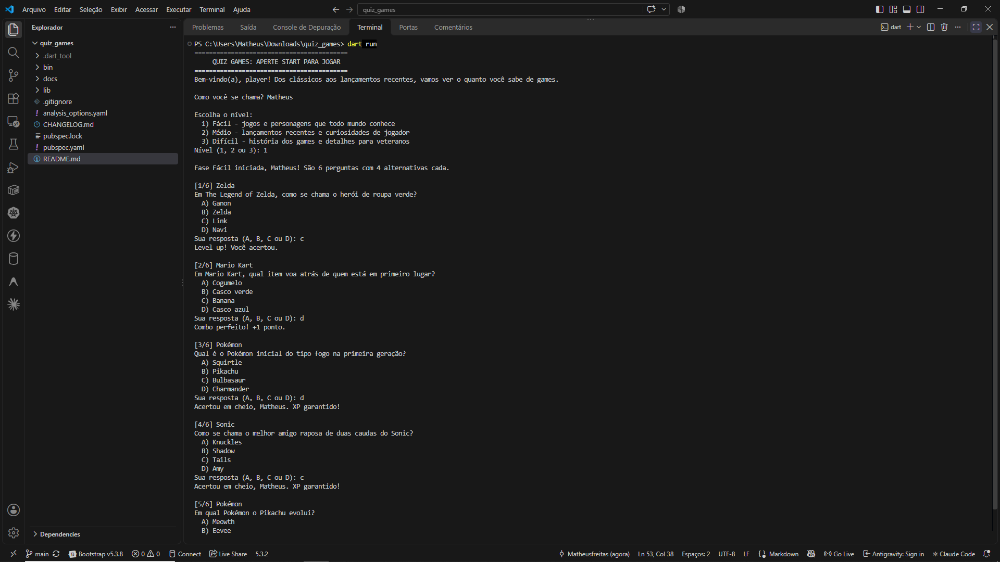
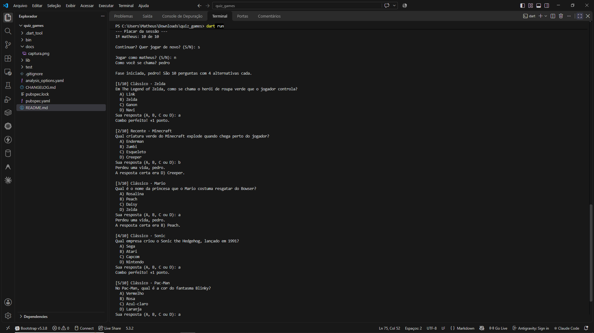
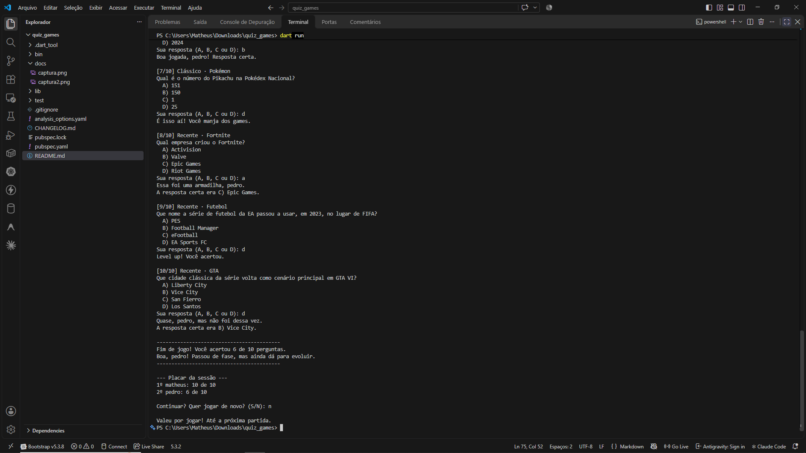

# Quiz Games

Desafio 02 - jogo de perguntas e respostas no terminal, feito em Dart.

**Integrantes:** Matheus Rabelo de Freitas
**Trilha:** Desenvolvimento Mobile

## Sobre o quiz

O tema é **videogames, dos clássicos aos lançamentos recentes**. O jogador escolhe um entre três níveis de dificuldade, e cada nível tem 6 perguntas de múltipla escolha com quatro alternativas (A, B, C e D), sendo só uma correta.

| Nível | O que cobra |
| --- | --- |
| Fácil | jogos e personagens que todo mundo conhece (Mario Kart, Among Us, Pokémon, Sonic, Zelda) |
| Médio | lançamentos recentes e curiosidades de jogador (GTA VI, Switch 2, Minecraft, EA Sports FC) |
| Difícil | história dos games e detalhes para veteranos (Pong, Tetris, Elden Ring, Jogo do Ano 2025) |

Exemplo de pergunta (nível Médio):

```
[2/6] Minecraft
Qual material é preciso para construir um portal para o Nether no Minecraft?
  A) Pedra
  B) Obsidiana
  C) Diamante
  D) Ferro
Sua resposta (A, B, C ou D):
```

### Como o jogo funciona

- Pergunta o nome do jogador e usa o nome nas mensagens.
- Pede para escolher o nível (1, 2 ou 3).
- Mostra uma pergunta por vez, com a categoria e as quatro alternativas.
- Aceita letra maiúscula ou minúscula.
- Se a resposta for inválida ou o jogador apertar só Enter, pede de novo.
- Quando o jogador erra, mostra qual era a alternativa correta.
- No fim, mostra a pontuação (ex.: `5 de 6 perguntas corretas`) e uma mensagem que depende do desempenho.

### Extras

- Três níveis de dificuldade, escolhidos pelo jogador a cada rodada.
- A ordem das perguntas muda a cada rodada, e a posição das alternativas também.
- As frases de acerto e de erro são sorteadas, para o jogo não ficar repetitivo.
- É possível jogar de novo, com o mesmo jogador ou com outro nome.
- Placar da sessão, com o nível de cada partida.


## Tecnologias

- Dart (SDK 3.5 ou superior)
- Pacotes de desenvolvimento: `lints`

## Como executar

Dentro da pasta do projeto:

```
dart pub get
dart run
```

## Estrutura

```
bin/quiz_games.dart    fluxo principal do jogo
lib/pergunta.dart      classe Pergunta
lib/perguntas.dart     lista com as perguntas
lib/entrada.dart       leitura e validação do que o jogador digita
lib/quiz.dart          rodada, mensagens e placar
test/                  testes automatizados
```

As perguntas ficam em uma lista e são mostradas por um `for`. Para incluir uma pergunta nova, basta adicionar um item em `lib/perguntas.dart`.

## Captura de tela
Tela inicial e perguntas:



Resposta certa, resposta errada e validação de entrada inválida:



Pontuação final e placar:



## Uso de IA

- **Como a IA ajudou:** gerou a primeira versão da estrutura do projeto e do código (classe `Pergunta`, lista de perguntas, leitura da entrada e laço `for`) e sugeriu perguntas para o tema de games.
- **O que adaptamos:** escolhi o tema depois de descartar um quiz que ficou parecido com o exemplo. Também pedi que o jogo permitisse trocar de jogador ao jogar de novo, que as frases fossem sorteadas e que as alternativas mudassem de posição.
- **Como verificamos:** joguei várias vezes com `dart run` testando respostas certas, erradas, letras minúsculas, respostas inválidas e Enter vazio, e conferi se a pontuação batia. As respostas das perguntas foram conferidas em fontes confiáveis.
